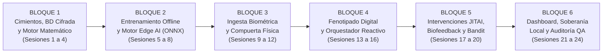

# Plan de Ejecución por Bloques, Fases y Metas por Sesión: **SynapseGuard (100% Local-First)**

Este documento traduce la arquitectura técnica de [plan_desarrollo_synapseguard.md](file:///c:/Users/Tumam/Music/proyecto%20catzim/plan_desarrollo_synapseguard.md) en un **plan operativo de construcción sesión por sesión**.

* **Estructura:** **6 Bloques de Desarrollo** $\rightarrow$ **12 Fases** $\rightarrow$ **24 Sesiones de Trabajo** (diseñadas como sesiones enfocadas de 2 a 4 horas cada una, donde cada sesión termina con código compilable y una prueba verificable).
* **Regla de Oro:** Ningún bloque depende de servidores externos ni servicios en la nube; todo el procesamiento, almacenamiento, inferencia, calibración y exportación ocurre **100% en el dispositivo**.

---

## Mapa General de Bloques y Fases

| Bloque | Fases Incluidas | Sesiones | Resultado Principal del Bloque |
| :--- | :--- | :---: | :--- |
| **Bloque 1: Núcleo Local, Criptografía y Estadística** | Fase 1.1: Esqueleto y Persistencia SQLCipher Fase 1.2: Motor Estadístico Circadiano | S01 – S04 | Base de datos AES-256 con llave en Hardware Keystore y motor de $Z\text{-scores}$ robustos + *Cold-Start*. |
| **Bloque 2: Pipeline ML y Motor Edge AI** | Fase 2.1: Entrenamiento Python y Exportación ONNX Fase 2.2: Inferencia Multimodal yAprendizaje Local | S05 – S08 | Modelos cuantizados INT8 corriendo en `< 10 ms` en Android con Fusión Tardía, explicabilidad y *Online SGD*. |
| **Bloque 3: Captura Biométrica y Contexto Físico** | Fase 3.1: Wearables (BLE + Health Connect) y Cámara PPG Fase 3.2: Acelerometría FIFO y Compuerta EPOC | S09 – S12 | Extracción de $\text{RMSSD}$ con o sin reloj inteligente y descarte dinámico de falsos positivos por actividad física. |
| **Bloque 4: Fenotipado Digital y Orquestador** | Fase 4.1: Telemetría de Uso y Cinemática Zero-Keylogging Fase 4.2: Agregador en RAM y Orquestación Híbrida | S13 – S16 | Captura de fragmentación atencional y tecleo sin leer caracteres, conectada en tiempo real al motor Edge AI. |
| **Bloque 5: Motor JITAI y Biofeedback Háptico** | Fase 5.1: Selección Contextual Bandit y Escudos UI Fase 5.2: Biofeedback Vagal, Smart Batching y EMA | S17 – S20 | Lazo cerrado de intervención adaptativa (pausa de 8s, respiración háptica a 6 rpm, retención de notificaciones). |
| **Bloque 6: UI/UX, Soberanía de Datos y QA** | Fase 6.1: Dashboard Compose y Exportación Cifrada/LAN Fase 6.2: Optimización de Batería y Cierre de Producción | S21 – S24 | App completa a 60/120 fps, backups `.synapse`, reportes PDF/HTML offline y consumo $< 2\%$ de batería diaria. |

---

## BLOQUE 1: Núcleo Local, Criptografía y Motor Estadístico
**Objetivo del Bloque:** Construir los cimientos del proyecto Android multi-módulo, el almacenamiento local cifrado sin servidor y el motor matemático de normalización circadiana que alimentará a toda la aplicación.

### Fase 1.1: Arquitectura Multi-Módulo y Persistencia Cifrada (`core-model` + `core-database`)

#### ✅ Sesión 01: Configuración del Proyecto Multi-Módulo y Dominio Puro *(COMPLETADA)*
* **Módulos objetivo:** `build-logic`, `app`, `core-model`
* **Tareas de la sesión:**
  1. [x] Crear el proyecto Android con catálogo centralizado de versiones (`gradle/libs.versions.toml`) usando Kotlin 2.x, Coroutines, Hilt y Jetpack Compose.
  2. [x] Configurar la estructura de módulos: `:app`, `:core-model`, `:core-database`, `:core-math-ml`, `:data-ingestors`, `:domain-orchestrator`, `:feature-jitai`, `:feature-dashboard`, `:feature-local-sovereignty`.
  3. [x] Definir en `:core-model` (Kotlin puro, sin dependencias de Android) los modelos de dominio inmutables: `FeatureWindow15m`, `CircadianBlock` (`MORNING`, `AFTERNOON`, `EVENING`, `LATE_NIGHT`), `ActivityState` (`REST`, `PHYSICAL_ACTIVITY`, `EPOC_COOLDOWN`), `StressInferenceResult`, `JitaiIntervention` y `EmaFeedback`.
  4. [x] Configurar las reglas de manifiesto base asegurando cero dependencias de servicios propietarios en la nube.
* **🎯 Meta de cierre (DoD):** *(Verificada)* El proyecto compila todos sus módulos con `./gradlew assembleDebug` y los modelos de dominio cuentan con tests unitarios básicos de serialización y validación de rangos (`:core-model:test` en verde).

#### ✅ Sesión 02: Cifrado con Android Keystore (`StrongBox`) y Base de Datos SQLCipher *(COMPLETADA)*
* **Módulos objetivo:** `core-database`
* **Tareas de la sesión:**
  1. [x] Implementar `KeystoreSecretManager` que genera una clave maestra AES-256-GCM dentro del `AndroidKeyStore` (habilitando `setIsStrongBoxBacked(true)` con fallback automático a `TEE`).
  2. [x] Generar la passphrase aleatoria de 32 bytes para SQLCipher en el primer inicio, cifrarla con la clave del Keystore y almacenarla en un archivo binario protegido en almacenamiento interno privado.
  3. [x] Implementar `SynapseDatabase` en Room integrada con `SupportOpenHelperFactory` de SQLCipher (`net.zetetic:android-database-sqlcipher`).
  4. [x] Crear las entidades Room, índices compuestos por timestamp/bloque circadiano y los DAOs (`WindowDao`, `BaselineDao`, `InferenceDao`, `InterventionDao`, `EmaDao`) más el trabajador de limpieza TTL (retención de 90 días y compactación `VACUUM`).
* **🎯 Meta de cierre (DoD):** *(Verificada)* Pruebas unitarias de cifrado envolvente AES-256-GCM y mapeo de entidades (`:core-database:testDebugUnitTest`) + suite instrumentada de cifrado SQLCipher y compactación TTL (`SynapseDatabaseEncryptedTest`) compiladas y en verde.

---

### Fase 1.2: Motor Estadístico Circadiano y Arranque en Frío (`core-math-ml`)

#### 🔹 Sesión 03: Estadísticos Robustos (Mediana, MAD y Transformación Logarítmica)
* **Módulos objetivo:** `core-math-ml`
* **Tareas de la sesión:**
  1. Implementar en Kotlin puro el calculador sin asignaciones innecesarias de memoria para **Mediana**, **MAD (*Median Absolute Deviation*)** y cuantiles (IQR).
  2. Programar la función de normalización robusta con saturación suave (*clipping* en $[-4.0, +4.0]$):
     $$Z_{\text{robusto}}(x) = \text{clip}\left( \frac{x - M_b}{1.4826 \cdot \text{MAD}_b + \epsilon}, -4.0, +4.0 \right)$$
  3. Implementar los pre-transformadores específicos de dominio: transformación $\ln(\text{RMSSD})$ para corregir la asimetría positiva de la variabilidad cardíaca y signo invertido ($-Z_{\ln(\text{RMSSD})}$) para alinear caída vagal con mayor puntaje de estrés.
* **🎯 Meta de cierre (DoD):** Suite de pruebas unitarias JUnit verificando que la inyección de un $20\%$ de *outliers* extremos no distorsiona el puntaje $Z_{\text{robusto}}$ en comparación con un $Z\text{-score}$ clásico.

#### 🔹 Sesión 04: Estratificación Circadiana y *Cold-Start* con Contracción Bayesiana
* **Módulos objetivo:** `core-math-ml`, `core-database`
* **Tareas de la sesión:**
  1. Implementar `CircadianBaselineEngine` que segmenta el historial de los últimos 14 días según los 4 bloques circadianos (`06–12h`, `12–18h`, `18–23h`, `23–06h`) y tipo de día (laboral vs. fin de semana), filtrando únicamente ventanas con `ActivityState == REST`.
  2. Programar el estimador de **Contracción Bayesiana (*Empirical Bayes Shrinkage*)** para resolver los primeros 14 días de uso (*Cold-Start*):
     $$\hat{M}_{x,b} = \alpha(n) M_{x,b}^{\text{usuario}} + (1 - \alpha(n)) \mu_{0,x,b}, \quad \text{con } \alpha(n) = \frac{n}{n + k}$$
  3. Definir la tabla JSON estática de priors fisiológicos y conductuales conservadores ($\mu_0, \sigma_0$) por rango de edad y bloque horario.
* **🎯 Meta de cierre (DoD):** Simulación automatizada de 14 días de datos sintéticos verificando una transición suave desde $\alpha = 0$ (Día 1) hasta $\alpha > 0.9$ (Día 14) sin saltos abruptos en los puntajes $Z$.

---

## BLOQUE 2: Pipeline ML Offline y Motor de Inferencia Edge AI
**Objetivo del Bloque:** Entrenar los modelos base en Python, exportarlos cuantizados a formato `.onnx` e integrarlos en Android junto con la Fusión Tardía, explicabilidad instantánea y aprendizaje incremental local.

### Fase 2.1: Entrenamiento Offline y Exportación Cuantizada (`ml-training-python`)

#### 🔹 Sesión 05: Preprocesamiento de Datasets y Generación de Ventanas Normalizadas
* **Módulos objetivo:** `ml-training-python/datasets`, `ml-training-python/features`
* **Tareas de la sesión:**
  1. Crear el entorno reproducible en Python (`pyproject.toml` con `scikit-learn`, `xgboost`, `lightgbm`, `neurokit2`, `onnx`, `onnxmltools`, `onnxruntime`).
  2. Programar el pipeline de extracción fisiológica sobre **WESAD** (y datos sintéticos complementarios de degradación de sensor comercial) para generar vectores $[Z_{\ln(\text{RMSSD})}, Z_{\text{RHR}}, Z_{\Delta\text{HR}_{\text{sed}}}, Z_{\text{DeudaSueño}}, Z_{\text{FragSueño}}, Z_{\text{EDA/Proxy}}]$.
  3. Programar el pipeline de extracción conductual basado en patrones de **StudentLife** + simulador estocástico de cinemática de interacción moderna (*doomscrolling*, $\text{IKI}$, *Backspace Ratio*, velocidad de *scroll*, micro-sesiones y minutos nocturnos).
* **🎯 Meta de cierre (DoD):** Generación de los datasets tabulares limpios (`physio_train.parquet` y `behav_train.parquet`) con validación de distribuciones y cero valores nulos o fugas de datos entre sujetos (*GroupKFold* por sujeto).

#### 🔹 Sesión 06: Entrenamiento de Ramas A/B, Cuantización ONNX y Test de Paridad
* **Módulos objetivo:** `ml-training-python/models`, `ml-training-python/export`
* **Tareas de la sesión:**
  1. Entrenar **Rama A (`physio_xgb`)** y **Rama B (`behav_lgbm`)** optimizando hiperparámetros para maximizar `ROC-AUC` y calibración de probabilidades (`Brier Score`).
  2. Exportar ambos modelos a `.onnx` (`physio_xgb_int8.onnx` y `behav_lgbm_int8.onnx`) con cuantización y generar un archivo JSON de vectores de prueba (`golden_test_vectors.json`) con entradas y salidas exactas.
  3. Extraer los pesos base y estructura de importancia direccional para el cálculo rápido de explicabilidad en el teléfono.
* **🎯 Meta de cierre (DoD):** Archivos `.onnx` con tamaño $< 500\text{ KB}$ cada uno, `ROC-AUC > 0.82` en validación cruzada por sujeto y script de verificación en Python que confirma paridad numérica entre el modelo original y el `.onnx`.

---

### Fase 2.2: Inferencia Multimodal, Explicabilidad y Personalización Local (`core-math-ml`)

#### 🔹 Sesión 07: Motor ONNX Runtime Mobile, Fusión Tardía Ponderada ($Q$) y Explicabilidad
* **Módulos objetivo:** `core-math-ml`
* **Tareas de la sesión:**
  1. Integrar `onnxruntime-android` y cargar los modelos `.onnx` desde `assets/` usando sesiones reutilizables en memoria (`OrtSession`).
  2. Implementar el calculador de calidad de señal fisiológica $Q_{\text{fisio}} \in [0, 1]$ (en función del tiempo desde la última lectura y porcentaje de artefactos) y la ecuación del Meta-Clasificador con término de sinergia:
     $$P(\text{Estrés}) = \sigma\left( \beta_0 + w_1 \beta_1 \text{logit}(P_{\text{fisio}}) + w_2 \beta_2 \text{logit}(P_{\text{cond}}) + \beta_{12} (P_{\text{fisio}} \cdot P_{\text{cond}}) \right)$$
  3. Implementar `LocalExplainabilityEngine` que identifica las **Top-2 variables detonantes** con su magnitud en desviaciones estándar y genera el texto explicativo legible en español (ej. *"Caída de 1.8 SD en VFC + 22 cambios de app en 15 min"*).
* **🎯 Meta de cierre (DoD):** Test en Android que ejecuta `golden_test_vectors.json` verificando diferencia $< 10^{-5}$ respecto a Python y latencia de inferencia completa $< 10\text{ ms}$.

#### 🔹 Sesión 08: Personalización On-Device (*Online SGD* para EMA + *Contextual Bandit LinUCB*)
* **Módulos objetivo:** `core-math-ml`, `core-database`
* **Tareas de la sesión:**
  1. Implementar `OnlineMetaClassifierCalibrator`: actualización incremental de $(\beta_0, \beta_1, \beta_2, \beta_{12})$ mediante **Descenso de Gradiente Estocástico con regularización L2 hacia el prior base** cada vez que el usuario responde una encuesta EMA (1 a 5).
  2. Implementar `JitaiContextualBandit` (algoritmo **LinUCB** con matrices pequeñas $d \times d$ en Kotlin puro, $d = 6$) para puntuar cuál de las 4 intervenciones tiene mayor expectativa de reducir el estrés del usuario dado el contexto actual (hora, $P_{\text{fisio}}$, $P_{\text{cond}}$, fatiga acumulada).
  3. Persistir los pesos actualizados y las matrices del Bandit en SQLCipher para que el aprendizaje sobreviva a reinicios del dispositivo.
* **🎯 Meta de cierre (DoD):** Prueba unitaria que simula 30 respuestas EMA y 20 recompensas de intervención, demostrando que el modelo adapta su umbral personal sin divergir (*weights bounded*) y prioriza la intervención más efectiva.

---

## BLOQUE 3: Captura Biométrica Multimodal y Contexto Físico
**Objetivo del Bloque:** Construir los conectores de hardware para obtener variabilidad de la frecuencia cardíaca ($\text{RMSSD}$), pulso y sueño tanto con relojes inteligentes como sin ellos (usando la cámara), junto con la compuerta de descarte de actividad física.

### Fase 3.1: Puente Biométrico de 3 Niveles (`biometric-ble-hc` + `biometric-camera-ppg`)

#### 🔹 Sesión 09: Conector BLE GATT en Tiempo Real (`0x180D`) y Filtro de Artefactos R-R
* **Módulos objetivo:** `data-ingestors:biometric-ble-hc`
* **Tareas de la sesión:**
  1. Implementar el escáner y cliente BLE GATT resiliente con reconexión exponencial para el servicio estándar de Frecuencia Cardíaca (`0x180D`) y característica `0x2A37`.
  2. Programar el decodificador binario de paquetes BLE para extraer múltiples intervalos $RR$ por notificación (conversión de unidades $1/1024\text{ s}$ a milisegundos).
  3. Implementar el filtro fisiológico en tiempo real: descarte de latidos fuera de $[300\text{ ms}, 2000\text{ ms}]$ y filtro de cociente móvil (descarte de diferencias $> 20\%$ respecto a la mediana local de 5 latidos para limpiar ectopias y ruido de movimiento).
  4. Calcular $\text{RMSSD}$, $\text{SDNN}$ y porcentaje de latidos válidos ($1 - \text{ArtifactRatio}$) en ventanas de 2 a 5 minutos.
* **🎯 Meta de cierre (DoD):** Verificación con simulador GATT o banda/reloj BLE real comprobando el cálculo exacto de $\text{RMSSD}$ frente a una serie de intervalos $RR$ conocida con artefactos inyectados.

#### 🔹 Sesión 10: Integración Incremental con *Jetpack Health Connect* y Proxy Cardiovascular
* **Módulos objetivo:** `data-ingestors:biometric-ble-hc`
* **Tareas de la sesión:**
  1. Implementar `HealthConnectIngestor` utilizando la API diferencial `getChangesToken` / `getChanges` para leer `HeartRateVariabilityRmssdRecord`, `RestingHeartRateRecord`, `HeartRateRecord` y `SleepSessionRecord`.
  2. Programar el calculador de **Deuda de Sueño Acumulada (3 noches)** y **Fragmentación del Sueño** (proporción de tiempo despierto intra-sueño).
  3. Implementar el **Proxy Autonómico Sedentario ($\Delta \text{HR}_{\text{sed}}$)** para wearables básicos que solo reportan BPM pero no RMSSD ni EDA.
* **🎯 Meta de cierre (DoD):** Prueba de ingesta leyendo registros de prueba de *Health Connect* y generando correctamente el vector biométrico aún cuando falten sensores opcionales como EDA.

#### 🔹 Sesión 11: Fotopletismografía Local por Cámara y Flash (`biometric-camera-ppg`)
* **Módulos objetivo:** `data-ingestors:biometric-camera-ppg`
* **Tareas de la sesión:**
  1. Implementar el capturador de `CameraX` (`ImageAnalysis` a 30 fps con control de exposición bloqueado y encendido de linterna/flash) para medición bajo demanda de 60 segundos con la yema del dedo.
  2. Programar el detector automático de colocación de dedo (validando la dominancia e intensidad del canal rojo y baja varianza espacial).
  3. Implementar en Kotlin el procesador digital de señal: remoción de tendencia lineal (*detrending*), **filtro paso banda Butterworth de 4.º orden ($0.7\text{–}3.5\text{ Hz}$)** y detector de picos sistólicos con interpolación parabólica para obtener intervalos pulso-a-pulso ($PP$) y calcular $\text{RMSSD}$ sin wearable.
* **🎯 Meta de cierre (DoD):** Medición real de 60 segundos poniendo el dedo en la cámara de un teléfono Android, obteniendo lecturas de BPM y $\text{RMSSD}$ estables con indicador de calidad de señal en tiempo real.

---

### Fase 3.2: Contexto Físico, Micro-Temblor y Compuerta EPOC (`context-sensors`)

#### 🔹 Sesión 12: Muestreo FIFO de Acelerómetro, Compuerta de Ejercicio Dinámica y Temblor en Mano
* **Módulos objetivo:** `data-ingestors:context-sensors`
* **Tareas de la sesión:**
  1. Implementar `PhysicalContextMonitor` registrando `TYPE_ACCELEROMETER` y `TYPE_STEP_DETECTOR` con *Hardware FIFO Batching* (`maxReportLatencyUs = 30_000_000`) para no despertar la CPU continuamente.
  2. Programar el cálculo de la Magnitud del Vector de Aceleración Dinámica ($\text{SVM}_t = |\sqrt{a_x^2 + a_y^2 + a_z^2} - g|$) y el acumulador exponencial de esfuerzo físico $E_t$ que determina dinámicamente el tiempo de enfriamiento post-ejercicio (**EPOC Cooldown** entre 5 y 45 minutos).
  3. Implementar el extractor de **Micro-Agitación Postural en Mano (*In-Hand Grip Tremor*)** en la banda de $4\text{–}12\text{ Hz}$ durante sesiones con pantalla encendida (usado como métrica adicional y como fallback si el usuario no activa Accesibilidad).
* **🎯 Meta de cierre (DoD):** Prueba en dispositivo caminando y en reposo verificando que la bandera `PHYSICAL_ACTIVITY` y la ventana `EPOC_COOLDOWN` se activan y desactivan con precisión sin superar el $0.4\%$ de uso de batería por hora.

---

## BLOQUE 4: Fenotipado Digital, Cinemática Táctil y Orquestador Reactivo
**Objetivo del Bloque:** Capturar las señales conductuales de fragmentación atencional, uso nocturno y cinemática de tecleo/scroll bajo estricto estándar *Zero-Keylogging*, e integrarlas en el orquestador en tiempo real.

### Fase 4.1: Telemetría de Uso y Cinemática Táctil Zero-Keylogging (`telemetry-usage` + `kinematics-accessibility`)

#### 🔹 Sesión 13: Telemetría de Uso, Micro-Sesiones y Entropía de Cambio de Apps
* **Módulos objetivo:** `data-ingestors:telemetry-usage`
* **Tareas de la sesión:**
  1. Implementar `AppUsageTelemetryIngestor` sobre `UsageStatsManager.queryEvents()` y un `BroadcastReceiver` para `ACTION_USER_PRESENT` / `ACTION_SCREEN_OFF`.
  2. Crear el clasificador local de paquetes (`AppCategoryCatalog`) con detección predeterminada de redes sociales/videos cortos, mensajería y productividad, editable localmente por el usuario.
  3. Calcular por ventana de 15 y 60 minutos: `unlock_rate`, `micro_session_ratio` (aperturas $< 15\text{ s}$), `app_switch_count`, **entropía de Shannon de transición entre apps**, `doomscroll_streak_minutes` y `night_screen_minutes`.
* **🎯 Meta de cierre (DoD):** Test en dispositivo validando el conteo exacto de desbloqueos, cambios rápidos de app y tiempo en redes sociales en los últimos 15 minutos.

#### 🔹 Sesión 14: Servicio de Accesibilidad *Zero-Keylogging* (IKI, Backspace Ratio y Scroll)
* **Módulos objetivo:** `data-ingestors:kinematics-accessibility`
* **Tareas de la sesión:**
  1. Configurar `KinematicsAccessibilityService` con XML estricto: `android:canRetrieveWindowContent="false"`, filtrando únicamente `TYPE_VIEW_TEXT_CHANGED`, `TYPE_VIEW_SCROLLED` y `TYPE_WINDOW_STATE_CHANGED`.
  2. Implementar el extractor volátil en memoria RAM (sin acceder jamás a `event.text`):
     * **Inter-Key Interval ($\text{IKI}$):** Mediana y coeficiente de variación ($\text{CV}_{\text{IKI}}$) de $\Delta t$ entre pulsaciones dentro de una ráfaga ($< 2000\text{ ms}$).
     * **Tasa de Corrección (*Backspace Ratio*):** Proporción de eventos donde `addedCount == 0 && removedCount > 0`.
     * **Cinemática de Scroll:** Velocidad media de *scroll* y frecuencia de ráfagas rápidas verticales (*scroll bursts*).
  3. Garantizar que el servicio funcione de manera opcional (degradación limpia al modo *Fallback* de Sesión 12 si el usuario decide no habilitarlo).
* **🎯 Meta de cierre (DoD):** Auditoría de memoria (*Heap Dump*) tras escribir 500 palabras en el teléfono comprobando que **ninguna cadena ni carácter** existe en la memoria de la aplicación, solo agregados numéricos estadísticos.

---

### Fase 4.2: Agregador en Memoria y Orquestación Híbrida (`domain-orchestrator`)

#### 🔹 Sesión 15: Ring Buffer en RAM y Evaluador Reactivo de Baja Latencia
* **Módulos objetivo:** `domain-orchestrator`
* **Tareas de la sesión:**
  1. Construir `SlidingWindowAggregator`: estructura *thread-safe* en memoria que mantiene los eventos de los últimos 15 y 60 minutos en un buffer circular de tamaño fijo.
  2. Implementar el **Disparador Reactivo por Sesión Interactiva**: cuando la pantalla está encendida y ocurre un cambio de aplicación hacia una app de riesgo o se cumplen 5 minutos de uso continuo en una misma app de `SHORT_VIDEO_SOCIAL`, el agregador consolida el vector actual, consulta la línea base circadiana en caché, pasa por la Compuerta de Contexto Físico y ejecuta la inferencia ONNX en `< 15 ms`.
* **🎯 Meta de cierre (DoD):** Prueba de integración extremo a extremo (sensores simulados $\rightarrow$ Ring Buffer $\rightarrow$ Normalización $Z$ $\rightarrow$ Inferencia ONNX $\rightarrow$ persistencia en SQLCipher) ejecutándose en menos de $15\text{ ms}$.

#### 🔹 Sesión 16: Trabajadores Nocturnos de `WorkManager` y Gestión de Ciclo de Vida
* **Módulos objetivo:** `domain-orchestrator`
* **Tareas de la sesión:**
  1. Implementar `NightlyBaselineWorker` (`PeriodicWorkRequest` cada 24 h con restricción de dispositivo en reposo/carga) para recalcular las medianas y MAD de los últimos 14 días en las 4 franjas circadianas.
  2. Implementar `PassiveSyncAndCleanupWorker` para sincronización incremental en segundo plano de *Health Connect*, resumen de datos mayores a 90 días y compactación de base de datos.
  3. Configurar el manejo de reinicio del teléfono (`ACTION_BOOT_COMPLETED`) para restaurar los monitores pasivos sin fricción.
* **🎯 Meta de cierre (DoD):** Ejecución forzada de los *Workers* mediante `WorkManagerTestInitHelper` verificando la actualización de la tabla `circadian_baselines` y la poda correcta de registros antiguos.

---

## BLOQUE 5: Motor de Intervención Adaptativa (JITAI) y Biofeedback Háptico
**Objetivo del Bloque:** Construir las 4 intervenciones adaptativas en tiempo real, el presupuesto anti-fatiga de alertas y el lazo de retroalimentación con micro-encuestas EMA.

### Fase 5.1: Presupuesto de Interrupción y Escudos Visuales (`feature-jitai`)

#### 🔹 Sesión 17: Gobernador Anti-Fatiga y Escudo de Fricción Consciente (Overlay de 8s)
* **Módulos objetivo:** `feature-jitai`
* **Tareas de la sesión:**
  1. Implementar `InterventionGovernor`: aplica reglas de enfriamiento entre alertas (máximo 1 intervención activa cada 60 min, backoff exponencial si el usuario pospone una alerta) e invoca a `JitaiContextualBandit` (Sesión 08) cuando $P(\text{Estrés}) > \theta_{\text{usuario}}$.
  2. Construir el **Escudo de Fricción Consciente** mediante `WindowManager` (`TYPE_APPLICATION_OVERLAY` con ciclo de vida de Jetpack Compose):
     * Animación fluida de pausa respiratoria de **8 segundos** al intentar abrir o prolongar el uso en una app de *doomscrolling* bajo sobrecarga autonómica.
     * Tarjeta de explicabilidad mostrando las **Top-2 causas detectadas** en lenguaje natural.
     * Botones de acción: **[Respirar 1 min]**, **[Cerrar app compulsiva]** o **[Continuar 10 min conscientes]**.
* **🎯 Meta de cierre (DoD):** Disparo en vivo del *Overlay* sobre una app de prueba cuando $P(\text{Estrés})$ supera el umbral, verificando que respeta el tiempo de enfriamiento y libera recursos de ventana al cerrarse.

#### 🔹 Sesión 18: Protector Circadiano Nocturno contra *Revenge Bedtime Procrastination*
* **Módulos objetivo:** `feature-jitai`
* **Tareas de la sesión:**
  1. Implementar `CircadianShieldController`: detecta el uso continuo de pantalla después de la hora objetivo de sueño configurada por el usuario combinado con fatiga o deuda de sueño elevada.
  2. Crear el filtro visual progresivo (*Warm Dimming Overlay* con `FLAG_NOT_TOUCHABLE` y `FLAG_NOT_FOCUSABLE`) que reduce el contraste y la luz azul gradualmente sin bloquear los toques en pantalla.
  3. Diseñar el modal de **Cierre Guiado de Jornada** de 30 segundos (descarga cognitiva de pendientes locales + activación rápida de modo descanso).
* **🎯 Meta de cierre (DoD):** Verificación en dispositivo del filtro de atenuación progresiva nocturna comprobando que los gestos táctiles pasan limpiamente a las aplicaciones subyacentes sin pérdidas de FPS.

---

### Fase 5.2: Biofeedback Vagal Háptico, Smart Notification Batching y EMA (`feature-jitai`)

#### 🔹 Sesión 19: Asistente de Biofeedback Vagal Háptico y Validación Autonómica en Vivo
* **Módulos objetivo:** `feature-jitai`
* **Tareas de la sesión:**
  1. Implementar `HapticVagalCoach` utilizando `VibratorManager` / `VibrationEffect.createWaveform(timings, amplitudes, -1)` (con fallback compatible para dispositivos sin control de amplitud fina):
     * **Modo 1 — Suspiro Fisiológico (60 s):** Doble inhalación ($2.5\text{ s} + 1.0\text{ s}$) y exhalación larga ($6.0\text{ s}$).
     * **Modo 2 — Frecuencia de Resonancia Barorrefleja (6 rpm, 2 a 5 min):** Inhalación gradual de $4.0\text{ s}$ y exhalación suave de $6.0\text{ s}$.
  2. Integrar lectura biométrica simultánea (vía BLE GATT o invitando a apoyar el dedo en la cámara PPG durante el ejercicio) para graficar al finalizar el **antes y después de $\text{RMSSD}$ y BPM** y registrar la recompensa $R$ en el *Contextual Bandit*.
* **🎯 Meta de cierre (DoD):** Ejecución completa de una sesión de respiración de 2 minutos con los ojos cerrados guiada únicamente por patrones hápticos, mostrando al final la gráfica de recuperación de $\text{RMSSD}$.

#### 🔹 Sesión 20: Agrupador Inteligente de Notificaciones (*Smart Batching*) y Micro-Encuestas EMA
* **Módulos objetivo:** `feature-jitai`
* **Tareas de la sesión:**
  1. Implementar `SmartBatchingNotificationService` (`NotificationListenerService`):
     * Cuando hay sobrecarga atencional ($Z_{\text{AppSwitches}} > 1.8$ o $P(\text{Estrés}) > 0.75$), silencia y almacena temporalmente en memoria cifrada las notificaciones de redes sociales y mensajería no prioritaria.
     * **Filtro estricto de seguridad:** Jamás retiene llamadas, alarmas, códigos 2FA/bancos ni contactos de la lista blanca prioritaria del usuario.
     * Entrega un **Resumen Agrupado (*Digest Notification*)** al finalizar el bloque de concentración o cada 2 horas.
  2. Implementar el sistema de **Micro-Encuestas EMA** mediante notificaciones con 5 botones de acción directa (*1: Muy relajado* a *5: Muy tenso*) que disparan el ajuste incremental *Online SGD* (Sesión 08) sin siquiera abrir la app.
* **🎯 Meta de cierre (DoD):** Prueba enviando notificaciones simuladas de distintas categorías durante un estado de estrés alto, comprobando que las urgentes pasan al instante, las secundarias se agrupan en el *Digest* y la encuesta EMA actualiza los pesos del modelo en un toque.

---

## BLOQUE 6: Dashboard en Jetpack Compose, Soberanía de Datos Local y QA
**Objetivo del Bloque:** Construir la interfaz gráfica de alto rendimiento, las herramientas de exportación/respaldo 100% locales que reemplazan cualquier necesidad de nube, y realizar la auditoría final de batería y privacidad.

### Fase 6.1: Interfaz de Usuario Reactiva y Soberanía de Datos (`feature-dashboard` + `feature-local-sovereignty`)

#### 🔹 Sesión 21: Onboarding Guiado de Permisos y Dashboard Biométrico-Conductual (60/120 fps)
* **Módulos objetivo:** `feature-dashboard`, `app`
* **Tareas de la sesión:**
  1. Crear el flujo de **Onboarding Transparente de Privacidad**: asistentes visuales paso a paso para conceder permisos de *Health Connect*, `PACKAGE_USAGE_STATS`, `SYSTEM_ALERT_WINDOW`, Notificaciones y (opcionalmente) `AccessibilityService`, explicando con claridad qué dato se mide y garantizando el procesamiento 100% local.
  2. Construir el **Dashboard Principal en Jetpack Compose** usando `Canvas` nativo optimizado:
     * Medidor en vivo de **Estado Autonómico vs. Carga Digital** con desglose de factores explicables.
     * Gráfica dual interactiva de **VFC ($\text{RMSSD}$) vs. Tiempo en Pantalla / Fragmentación Atencional**.
     * Mapa de calor circadiano de los últimos 14 días y progreso de calibración de la línea base.
* **🎯 Meta de cierre (DoD):** Navegación completa por el Onboarding y el Dashboard manteniendo **60/120 fps constantes** (0 *jank frames* en *Layout Inspector*) con soporte para tema oscuro adaptativo.

#### 🔹 Sesión 22: Respaldos Cifrados `.synapse`, Reportes PDF/HTML Offline y Portal Web LAN Efímero
* **Módulos objetivo:** `feature-local-sovereignty`
* **Tareas de la sesión:**
  1. Implementar el exportador/importador de **Respaldos Locales Cifrados (`.synapse`)** vía Android *Storage Access Framework* (SAF), derivando una clave de usuario mediante **Argon2id** + **AES-256-GCM** para portabilidad segura entre teléfonos sin usar la nube.
  2. Implementar `OfflineReportGenerator`: genera reportes semanales y mensuales en **PDF nativo (`PdfDocument`) y HTML autocontenido con gráficas SVG** listos para guardar o compartir localmente.
  3. Implementar el **Portal Web LAN Efímero (Opcional):** un micro-servidor `Ktor CIO` embebido que solo se enciende bajo demanda durante 15 minutos en la red Wi-Fi local (`http://<IP-local>:8443`), protegido por un PIN temporal de 6 dígitos en pantalla, para explorar el historial en el navegador de una PC en la misma casa sin conexión a Internet.
* **🎯 Meta de cierre (DoD):** Exportación e importación exitosa de un archivo `.synapse` en otro dispositivo/emulador, generación de un PDF de 2 páginas en `< 2\text{ s}` y acceso al Dashboard desde el navegador local vía Wi-Fi con el teléfono sin salida a Internet.

---

### Fase 6.2: Endurecimiento, Perfilado de Batería y Cierre de Producción

#### 🔹 Sesión 23: Auditoría de Consumo Energético, Memoria y Privacidad (*Zero-Leak Verification*)
* **Módulos objetivo:** Todos los módulos (`:app` integrada)
* **Tareas de la sesión:**
  1. Ejecutar pruebas de perfilado con **Android Studio Energy & Memory Profiler** y **Perfetto** durante un ciclo simulado de uso intensivo y reposo (*Doze*).
  2. Ajustar intervalos de *batching* y liberación de *coroutines* para asegurar que el consumo total se mantenga **por debajo del 2% de batería diaria** y la huella de RAM en segundo plano sea $< 45\text{ MB}$.
  3. Ejecutar la **Auditoría de Privacidad y Red**: verificar mediante captura de tráfico e inspección estática que la aplicación realiza **0 peticiones a servidores en Internet** y que el recolector de basura limpia inmediatamente los eventos temporales de UI.
* **🎯 Meta de cierre (DoD):** Reporte técnico de perfilado cumpliendo los umbrales de CPU ($< 15\text{ ms}$ por inferencia), RAM ($< 45\text{ MB}$ en background), Batería ($< 2\%/\text{día}$) y Red ($0\text{ bytes}$ hacia Internet).

#### 🔹 Sesión 24: Reglas R8/ProGuard, Suite de Pruebas E2E y Empaquetado Release
* **Módulos objetivo:** `:app`
* **Tareas de la sesión:**
  1. Configurar reglas de ofuscación y reducción de código con **R8 en modo completo (`isMinifyEnabled = true`, `isShrinkResources = true`)**, preservando las firmas JNI de `SQLCipher` y `ONNX Runtime`.
  2. Ejecutar la suite completa de pruebas automatizadas (Unitarias + Instrumentadas E2E simulando un usuario en *Cold-Start*, detección de ejercicio, episodio de *doomscrolling* con estrés fisiológico, intervención háptica y mejora de $\text{RMSSD}$).
  3. Generar el APK/Bundle de lanzamiento firmado y redactar la guía rápida de despliegue y pruebas piloto.
* **🎯 Meta de cierre (DoD):** APK Release firmado, optimizado y funcional al 100% en modo avión permanente, con todas las pruebas unitarias e instrumentadas en verde.

---

## Resumen Rápido de Seguimiento por Sesión (Checklist de Progreso)

- [ ] **Bloque 1 — Cimientos y Estadística Local**
  - [x] **Sesión 01:** Esqueleto multi-módulo Gradle + modelos de dominio en `:core-model`. *(Completada)*
  - [x] **Sesión 02:** Llave maestra en Android Keystore (`StrongBox`) + Room cifrado con SQLCipher y política TTL. *(Completada)*
  - [ ] **Sesión 03:** Estadísticos robustos en Kotlin (Mediana, MAD, transformación $\ln(\text{RMSSD})$).
  - [ ] **Sesión 04:** Motor de Línea Base Circadiana (4 bloques horarios) + *Cold-Start* con Contracción Bayesiana.
- [ ] **Bloque 2 — Entrenamiento ML y Motor Edge AI**
  - [ ] **Sesión 05:** Preprocesamiento en Python (WESAD + StudentLife + trazas sintéticas normalizadas).
  - [ ] **Sesión 06:** Entrenamiento XGBoost/LightGBM, cuantización a `.onnx` (`INT8`) y vectores de paridad.
  - [ ] **Sesión 07:** Inferencia en Android con `ONNX Runtime Mobile`, Fusión Tardía ponderada ($Q$) y explicabilidad Top-2.
  - [ ] **Sesión 08:** Aprendizaje incremental local (*Online SGD* para EMA + *Contextual Bandit LinUCB* para JITAI).
- [ ] **Bloque 3 — Ingesta Biométrica y Contexto Físico**
  - [ ] **Sesión 09:** Cliente BLE GATT (`0x180D`) en vivo + filtro de artefactos ectópicos en intervalos $RR$.
  - [ ] **Sesión 10:** Conector diferencial de *Health Connect* (`ChangesToken`) + deuda de sueño y proxy $\Delta\text{HR}_{\text{sed}}$.
  - [ ] **Sesión 11:** Fotopletismografía por cámara y flash (`CameraX` + filtro Butterworth + $\text{RMSSD}$ sin reloj).
  - [ ] **Sesión 12:** Monitor físico con *FIFO Batching* ($\text{SVM}$, pasos, enfriamiento dinámico *EPOC* y temblor en mano).
- [ ] **Bloque 4 — Fenotipado Digital y Orquestador Reactivo**
  - [ ] **Sesión 13:** Telemetría de `UsageStatsManager` (desbloqueos, micro-sesiones, entropía de apps y uso nocturno).
  - [ ] **Sesión 14:** `AccessibilityService` *Zero-Keylogging* ($\text{IKI}$, *Backspace Ratio* y velocidad de *scroll* en RAM).
  - [ ] **Sesión 15:** *Ring Buffer* en memoria + evaluador reactivo de baja latencia al interactuar con la pantalla.
  - [ ] **Sesión 16:** Trabajadores nocturnos de `WorkManager` (recálculo de líneas base y compactación de BD).
- [ ] **Bloque 5 — Intervenciones JITAI y Biofeedback**
  - [ ] **Sesión 17:** Gobernador anti-fatiga de alertas + Escudo de Fricción Consciente (*Overlay* de 8 segundos).
  - [ ] **Sesión 18:** Protector Circadiano Nocturno (atenuación progresiva + cierre guiado de jornada).
  - [ ] **Sesión 19:** Asistente de Biofeedback Vagal Háptico (`VibrationEffect` a 6 rpm + validación de $\Delta\text{RMSSD}$).
  - [ ] **Sesión 20:** *Smart Notification Batching* (con lista blanca de urgencias) + micro-encuestas EMA en 1 toque.
- [ ] **Bloque 6 — UI/UX, Soberanía de Datos y QA Final**
  - [ ] **Sesión 21:** Onboarding transparente de permisos + Dashboard en Jetpack Compose a 60/120 fps.
  - [ ] **Sesión 22:** Exportación/importación `.synapse` (Argon2id/AES), reportes PDF/HTML offline y servidor LAN efímero.
  - [ ] **Sesión 23:** Perfilado de batería ($< 2\%/\text{día}$), memoria ($< 45\text{ MB}$) y auditoría de cero tráfico a Internet.
  - [ ] **Sesión 24:** Optimización R8/ProGuard, suite de pruebas E2E en modo avión y generación del APK Release.

